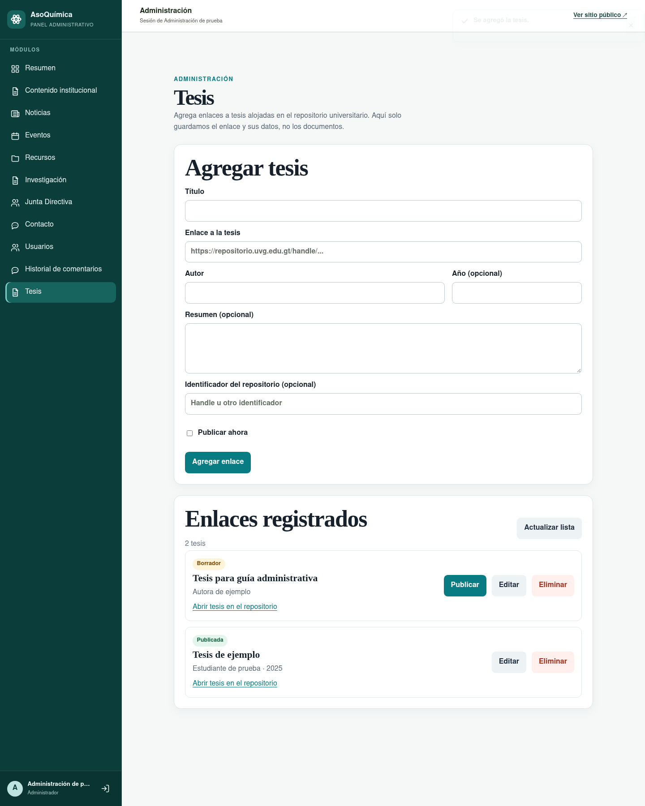
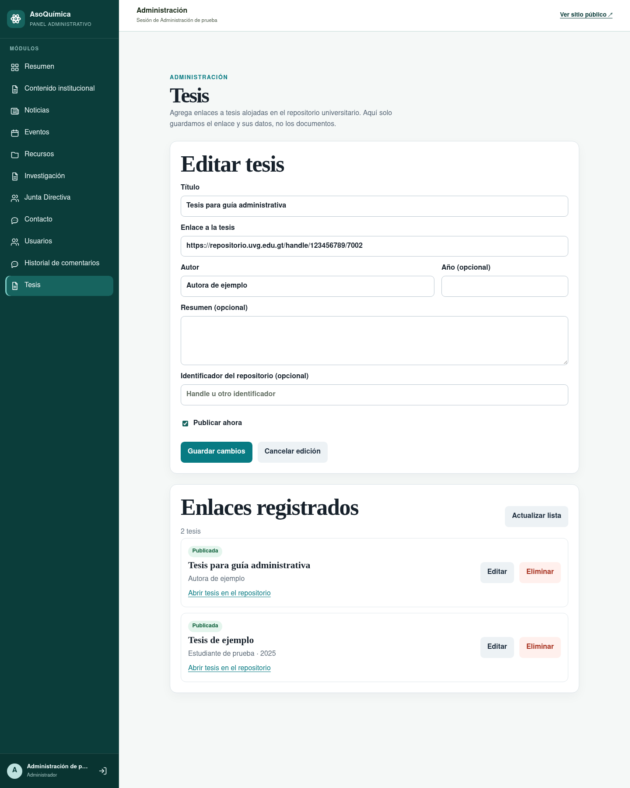

# Administrar enlaces de tesis

Esta guía aplica a integrantes de junta con una cuenta administrativa autorizada para `PAPERS_MANAGE`. Los permisos se revisan en el servidor; ser estudiante no da acceso a estas acciones.

## Agregar y publicar

1. Inicia sesión en `/administrador` y abre **Tesis** en el menú lateral.
2. Completa título, URL HTTPS del repositorio, autor principal, año y resumen. Puedes seleccionar una persona existente o registrar una nueva.
3. Agrega los coautores. El autor principal ocupa el primer lugar y los coautores aparecen automáticamente en orden alfabético.
4. Deja **Publicar ahora** desmarcado para guardar un borrador, o márcalo para publicar de inmediato.
5. Pulsa **Agregar enlace** o **Publicar tesis**, revisa el mensaje de confirmación y confirma la acción.

Un borrador aparece en **Enlaces registrados** con el botón **Publicar**. Al confirmarlo, la tesis pasa al catálogo público. El listado se puede actualizar con **Actualizar lista**.

## Editar o retirar

- Pulsa **Editar** junto al registro. Cambia los datos necesarios y elige **Guardar cambios**; confirma para guardar.
- Pulsa **Eliminar** para retirar el enlace de AEQUVG y confirma la acción. La tesis y su archivo siguen en el repositorio universitario; la aplicación no envía una petición para borrarlos.
- Los mensajes de confirmación, éxito y error aparecen en la pantalla. La URL debe usar HTTPS y se normaliza al guardar; una URL normalizada ya registrada produce un aviso de duplicado.

La URL externa puede exigir iniciar sesión en UVG o tener otra restricción. AEQUVG no elude esos controles ni descarga el documento.

## Matriz de campos acordada (S6-04, vinculada a SCRUM-300)

| Campo | Obligatorio | Regla |
| --- | --- | --- |
| Título | Sí | Entre 3 y 300 caracteres. |
| URL del repositorio | Sí | Solo HTTPS; única entre tesis tras recortar espacios externos y normalizar esquema y host. Se conserva la ruta. |
| Autoría | Sí | Un autor principal obligatorio y cero o más coautores, mostrados alfabéticamente. Los registros existentes se reutilizan por selección explícita. |
| Año | Sí | Entero entre 1900 y 9999. |
| Resumen | Sí | Entre 1 y 12 000 caracteres después de quitar espacios externos. |

La vista y la API aplican la misma matriz. El identificador de repositorio se retiró del contrato y de la interfaz. No hay slug manual ni carga de documentos en este módulo.

La autoría se guarda como personas vinculadas a la tesis, con una relación principal y coautores numerados. La migración conserva cada autor anterior como una sola persona principal, sin dividir cadenas; el campo API `author` se mantiene como alias de compatibilidad.

El proceso actual es manual: la junta ingresa el enlace y decide la publicación. La detección automática o la importación para aprobación fueron investigadas, pero no están implementadas ni activadas.

## Modelo, contrato y evidencias

- [Contrato de API del flujo manual, campos, rutas y permisos](https://github.com/alemanuel18/aequvg-backend/blob/test/thesis-s6-10-manual-flow/docs/thesis-manual-flow-api.md).
- [OpenAPI local](http://localhost:3000/openapi) y colección `docs/aequvg-hoppscotch.json` del backend.
- [Matriz de pruebas](../thesis-e2e-permissions.md), [defectos y re pruebas](../thesis-defect-log.md) e [investigación del repositorio UVG](https://github.com/alemanuel18/aequvg-backend/blob/docs/thesis-documentation/docs/thesis-repository-research.md).
- [Estado de acuerdos y pendientes con el cliente](../thesis-scope-status.md).

Las capturas usan datos demostrativos y una API simulada; no muestran datos de una tesis real. La modalidad vigente es manual; el formulario no sincroniza con UVG ni crea una etapa de aprobación de una segunda persona. La validación de una junta real y el caso de un documento restringido siguen pendientes.
