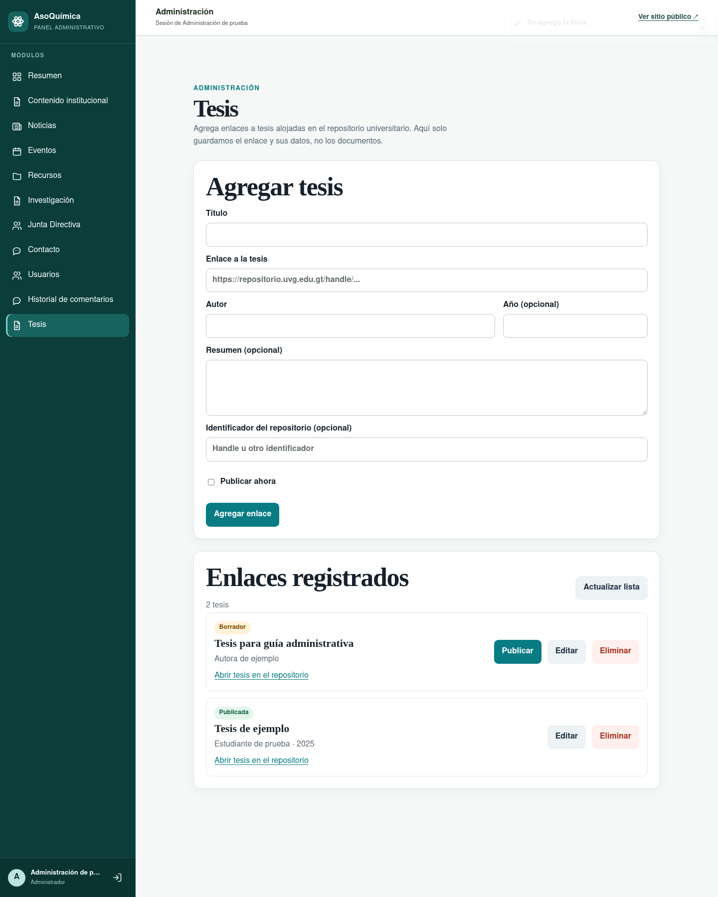
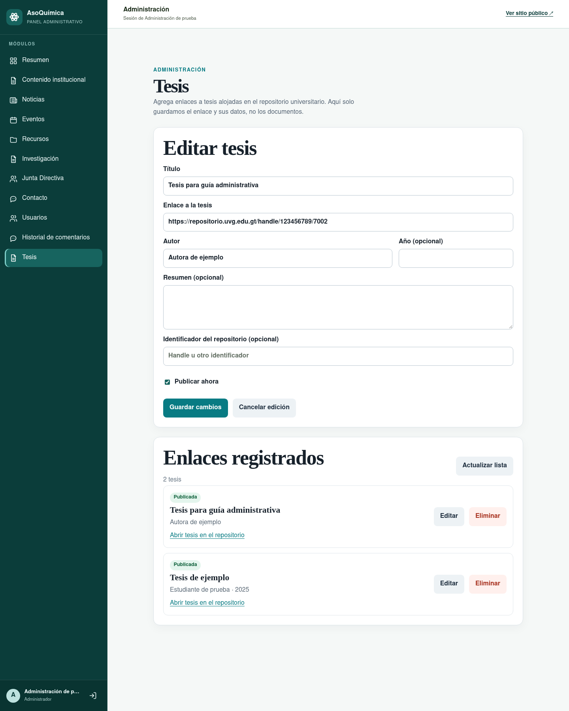

# Administrar enlaces de tesis

Esta guía aplica a integrantes de junta con una cuenta administrativa autorizada para `PAPERS_MANAGE`. Los permisos se revisan en el servidor; ser estudiante no da acceso a estas acciones.

## Agregar y publicar

1. Inicia sesión en `/administrador` y abre **Tesis** en el menú lateral.
2. Completa título, enlace al registro de la tesis en UVG y autoría.
3. Si están disponibles, agrega año, resumen e identificador del repositorio. El año, resumen e identificador son opcionales.
4. Deja **Publicar ahora** desmarcado para guardar un borrador, o márcalo para publicar de inmediato.
5. Pulsa **Agregar enlace** o **Publicar tesis**, revisa el mensaje de confirmación y confirma la acción.

Un borrador aparece en **Enlaces registrados** con el botón **Publicar**. Al confirmarlo, la tesis pasa al catálogo público. El listado se puede actualizar con **Actualizar lista**.

## Editar o retirar

- Pulsa **Editar** junto al registro. Cambia los datos necesarios y elige **Guardar cambios**; confirma para guardar.
- Pulsa **Eliminar** para retirar el enlace de AEQUVG y confirma la acción. La tesis y su archivo siguen en el repositorio universitario; la aplicación no envía una petición para borrarlos.
- Los mensajes de confirmación, éxito y error aparecen en la pantalla. URL mal formada o con protocolo distinto de HTTP/HTTPS se rechaza; URL o identificador repetidos producen un aviso de duplicado.

La URL externa puede exigir iniciar sesión en UVG o tener otra restricción. AEQUVG no elude esos controles ni descarga el documento.

## Campos obligatorios: discrepancia pendiente

La aceptación de documentación de esta tarea pide describir **URL como único campo obligatorio**. El formulario vigente, sin embargo, requiere **título, URL y autor**; la API exige título y URL y permite omitir autor. La prueba E2E intentó guardar solo la URL y confirmó que la pantalla lo bloquea. Se conserva el formulario actual conforme a la decisión previa de mantener título y autor obligatorios; no se debe indicar al equipo que URL por sí sola basta hasta que el alcance se alinee y el producto se actualice.

El proceso actual es manual: la junta pega el enlace y administra la publicación. La detección automática o la importación para aprobación fueron investigadas, pero no están implementadas ni activadas. No hay confirmación del cliente sobre una modalidad automática en los registros disponibles.

## Modelo, contrato y evidencias

- [Modelo, rutas, permisos y errores de API](https://github.com/alemanuel18/aequvg-backend/blob/docs/thesis-documentation/docs/thesis-links.md).
- [OpenAPI local](http://localhost:3000/openapi) y colección `docs/aequvg-hoppscotch.json` del backend.
- [Matriz de pruebas](../thesis-e2e-permissions.md), [defectos y re pruebas](../thesis-defect-log.md) e [investigación del repositorio UVG](https://github.com/alemanuel18/aequvg-backend/blob/docs/thesis-documentation/docs/thesis-repository-research.md).
- [Estado de acuerdos y pendientes con el cliente](../thesis-scope-status.md).

Las capturas usan datos demostrativos y una API simulada; no muestran datos de una tesis real. La validación de una junta real y el caso de un documento restringido siguen pendientes.
