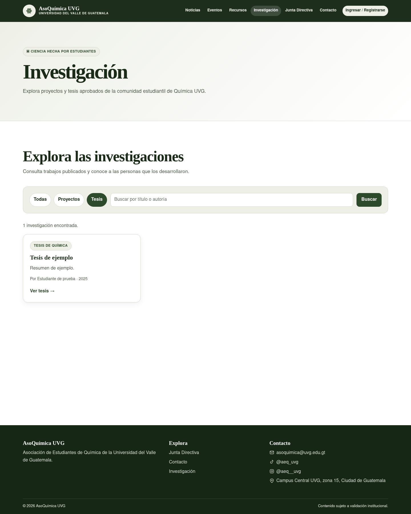
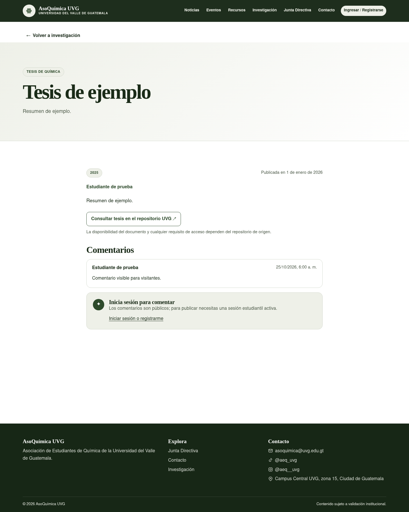

# Consultar tesis de Química

## Buscar y abrir una tesis

1. Abre **Investigación** desde el menú público o visita `/investigacion`.
2. Selecciona **Tesis** para mostrar solo las tesis publicadas.
3. Si lo necesitas, escribe palabras del título o del nombre de autoría y pulsa **Buscar**.
4. En la tarjeta de la tesis, pulsa **Ver tesis** para revisar sus datos.
5. Pulsa **Consultar tesis en el repositorio UVG** para abrir la ficha original en otra pestaña.

La ficha presenta título, autoría, año y resumen cuando esos datos están disponibles. En ella encontrarás el enlace original. **El archivo permanece en el repositorio de UVG**; AEQUVG solo muestra el enlace y los metadatos. La disponibilidad del documento y cualquier requisito de acceso (por ejemplo, iniciar sesión en UVG) dependen del repositorio.

Si una tesis no aparece, revisa que esté publicada o busca por menos palabras. Si el enlace abre una página de acceso restringido o ya no está disponible, contacta a la unidad que administra el repositorio UVG; AEQUVG no puede cambiar esos permisos.

La consulta pública no requiere una cuenta de estudiante. La pantalla de detalle puede incluir comentarios; publicar un comentario requiere iniciar sesión como estudiante UVG.

## Información para equipo técnico

- [Contrato y modelo de enlaces](https://github.com/alemanuel18/aequvg-backend/blob/docs/thesis-documentation/docs/thesis-links.md).
- [Pruebas E2E, permisos y defectos](../thesis-e2e-permissions.md) y [registro de defectos con repeticiones](../thesis-defect-log.md).
- [Investigación del repositorio y límites de automatización](https://github.com/alemanuel18/aequvg-backend/blob/docs/thesis-documentation/docs/thesis-repository-research.md).

Las capturas usan datos demostrativos de una API simulada; no representan una tesis real ni el acceso efectivo a UVG.
